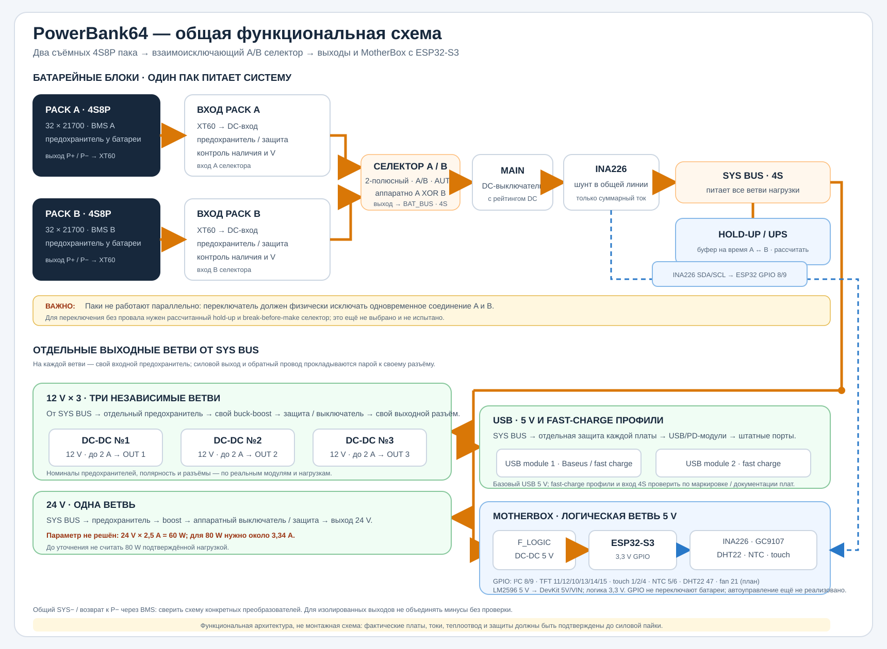
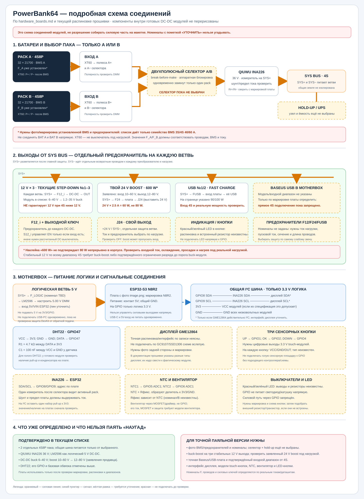
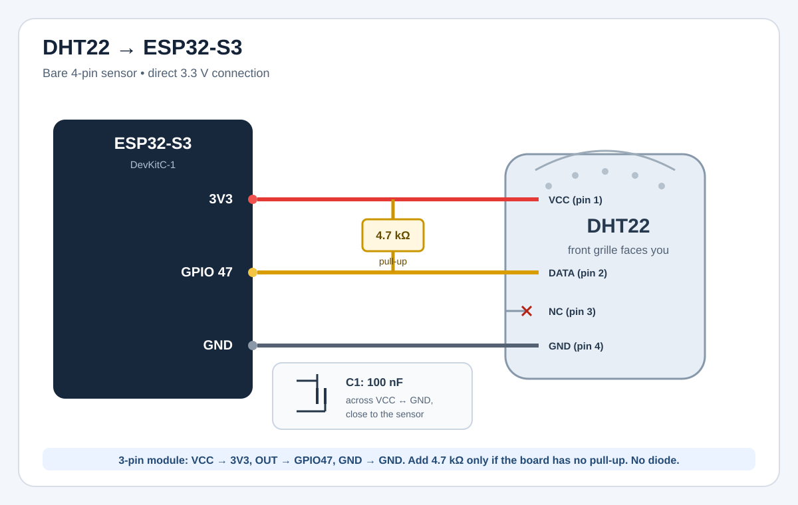

# DJ Power Bank — схема соединений и план ESP32

Статус: проектный документ v0.1, 23.10.2026. Это функциональная схема для выбора компонентов и стендовой проверки, а не готовая схема для пайки. Номиналы предохранителей, шин, проводов и силовых ключей нельзя назначить по названиям из списка покупок: нужны точные модели, даташиты, длины проводов и тепловые испытания.

Связанные документы: [спецификация](DJ_PowerBank_README.md), [план работ](ACTION_PLAN.md), [компоновка](Final_Layout_SidePacks.md), [исходный список](LIST.md).

## Общая схема проекта



Схема показывает целевую архитектуру: в каждый момент к BAT_BUS подключён только один pack. A/B коммутируются взаимоисключающим селектором; ORing и параллельная работа паков не используются. Переключение без провала ещё требует выбора узла, расчёта hold-up и стендовой проверки.

### Подробная схема соединений модулей



Схема использует компоненты, перечисленные в `hardware_boards.md`, и показывает известные подключения ESP32-S3/DHT22. Жёлтым отмечены ещё не выбранные или не идентифицированные узлы. Это не готовая схема для пайки: фактические модели дисплея, селектора, hold-up, BMS, преобразователей и кнопок нужно сверить до назначения номиналов.

## 1. Сначала фиксируем выходную мощность

Запись «24 V, 2,5 A, 80 W» противоречива: `24 × 2,5 = 60 W`. Возможны два варианта:

| Вариант | Номинал выхода | Что должен обеспечивать 24 V преобразователь |
|---|---:|---|
| A — по указанному току | 24 V, 2,5 A = 60 W | Не менее 60 W непрерывно плюс согласованный запас на температуру и пуск |
| B — по указанной мощности | 24 V, 3,34 A ≈ 80 W | Не менее 80 W непрерывно плюс согласованный запас на температуру и пуск |

Пока решение не принято, силовая часть описана как вариант B, а рабочая нагрузка не считается утверждённой. Три выхода 12 V × 2 A — это до 72 W суммарно, если каждый может работать одновременно. USB-модули пока не добавляются к гарантированному бюджету: надписи 90/100 W не подтверждают входной диапазон от 4S, одновременную мощность портов или работу на минимальном напряжении батареи.

## 2. Функциональная схема

```text
  PACK A: 4S8P → BMS A → F_A у pack → J_A → входная защита ─┐
                                                             ├→ селектор A/B
  PACK B: 4S8P → BMS B → F_B у pack → J_B → входная защита ─┘  (только один вход ON)
                                                                  → BAT_BUS+
  BAT_BUS+ → MAIN DC → INA226 → SYS+                         BAT_BUS−
                                                                  │
  SYS+ ─ F12_1 → buck-boost 12 V → выходной ключ/защита → J12_1 (+,−)
       ├ F12_2 → buck-boost 12 V → выходной ключ/защита → J12_2 (+,−)
       ├ F12_3 → buck-boost 12 V → выходной ключ/защита → J12_3 (+,−)
       ├ F24   → boost 24 V → выходной ключ/защита → J24 (+,−)
       ├ FUSB1 → USB-модуль 1 → его штатные USB-порты
       ├ FUSB2 → USB-модуль 2 → его штатные USB-порты
       └ FLOGIC → отдельный LM2596, настроенный на 5 V → ESP32-S3, OLED,
                   датчики и логика MotherBox

  SYS− = BAT_BUS− = возврат через выход BMS выбранного pack.
  Зарядка: снятый pack → отдельный совместимый 4S CC/CV зарядник → штатные
  зарядные выводы конкретной BMS. Зарядный ток через базу и USB-входы только (Basesus USB fast charge with display).
```

**Параллельного соединения паков не будет.** Нужен DC-селектор, отключающий оба провода невыбранного pack, с аппаратной блокировкой одновременного включения A и B. Для полностью раздельного переключения используется break-before-make: сначала отключается выбранный pack, затем подключается второй. В этот интервал питание нагрузки должен удерживать рассчитанный накопитель энергии на SYS_BUS либо другой специально спроектированный узел. Его ёмкость, ESR, ток пульсаций и время переключения определяются по реальной нагрузке и проверяются осциллографом; обычный случайный конденсатор не гарантирует работу без перезапуска.

Ручной режим может выбирать A/B/OFF; автоматический режим может переключать на второй pack по подтверждённому порогу. В обоих режимах аппаратная блокировка должна исключать одновременное соединение обоих проводов батарей. ESP32 не должна быть единственной защитой переключения. До выбора и испытания селектора и hold-up узла перед снятием pack отключать нагрузку. XT60 не считать разъёмом для коммутаций под током. Механическая защёлка несёт массу pack; разъём не использовать как крепление. Точные выводы B−/B1…B4/P−/C− подключать только по инструкции установленной BMS.

## 3. План разветвления питания и защиты

| Ветвь | Нагрузка и начальное требование | Что определить до выбора деталей |
|---|---|---|
| PACK A/B | Каждый 4S8P; независимые BMS и предохранители; двухполюсный взаимоисключающий селектор | Реальный ток ячеек и BMS, схема BMS, DC-рейтинг селектора, время перевода, hold-up и предел одного pack |
| 12 V №1–3 | По 12 V / 2 A непрерывно на выход; 24 W на ветвь | Допуск устройства, пусковой ток, разъём и полярность; buck-boost должен держать ток при входе во всём диапазоне |
| 24 V | Пока резервировать до 80 W; 3,34 A при 24 V | Зафиксировать вариант 60/80 W; уточнить пусковой пик, допуск напряжения и разъём. Для boost проверить OFF: у некоторых схем вход проходит на выход даже при EN=0 |
| USB №1/2 | Использовать только выходы штатных модулей | Сфотографировать маркировку/платы, найти схему и входной диапазон; нагрузить все порты одновременно и проверить PD-профили |
| Логика MotherBox | Собственный DC/DC 5 V от защищённой SYS+/SYS− шины; отдельный FLOGIC | Уточнить плату, входной диапазон для 4S, ток, пульсации/помехи, нагрев и поведение при переключении pack |

Для каждого DC-выхода: отдельная защита ветви перед преобразователем и защита/ограничение после него, если этого требует выбранная топология. Предохранитель защищает проводку от аварийного тока, но не заменяет BMS, ограничение тока или термозащиту. Номинал и время срабатывания выбираются по самому слабому элементу ветви, а не только по рабочей нагрузке.

LM2596 выбран как отдельный понижающий модуль 5 V для MotherBox. Проверить маркировку именно установленной платы: название микросхемы не гарантирует качество клона, реальный ток, охлаждение или уровень пульсаций. Перед подключением ESP32 выставить выход ровно 5 V мультиметром без нагрузки, затем повторно проверить его под ожидаемой нагрузкой. Вход подключать только к защищённой SYS+/SYS− шине после проверки допустимого диапазона платы на всём диапазоне 4S pack; выход 5 V — к входу 5V/VIN DevKit, который указан производителем платы, а не к GPIO и не к 3V3. Не соединять одновременно с USB компьютера, пока не проверена схема развязки/питания конкретного DevKit: возможна обратная подача 5 V.

Отдельная ветвь LM2596 отделяет питание логики от нагрузочных преобразователей, но сама по себе **не означает гальваническую изоляцию** и не гарантирует отсутствия помех в аудио. Общая земля остаётся связанной, если у конкретного преобразователя явно не подтверждена безопасная изоляция. Проверить температуру модуля, пульсации и поведение на реальной аудионагрузке; не добавлять конденсаторы наугад.

Если суммарно включить три 12 V выхода (72 W), 24 V выход (до 80 W) и USB, батарейный ток быстро станет большим. Программный лимит ESP32 может запретить запуск дополнительных ветвей, но не является единственной защитой. Итоговые ограничения должны быть аппаратными либо опираться на проверенные сигналы преобразователей и защит.

## 4. Соединители и предварительная распиновка

### Pack → база

Для силового соединения использовать один ключованный двухконтактный разъём на pack. Маркировку сделать на корпусе с обеих сторон; проверить полярность мультиметром перед первым подключением. Обозначения «male/female» у продавца не считать указанием полярности.

| Контакт J_A/J_B | Сигнал | Примечание |
|---|---|---|
| 1 | PACK+ после предохранителя и защищённого выхода BMS | Полярность подтвердить по фактической BMS; не брать плюс с ячеек до BMS |
| 2 | PACK− с защищённого силового вывода BMS | Не обходить MOSFET BMS соединением с B− |

Не назначать балансировочные контакты на базовом силовом разъёме. Если позже понадобятся ID/температура/smart-BMS, добавить отдельный ключованный сигнальный разъём и защиту от ESD/паразитного питания; распиновку определить по выбранной электронике.

### Выходы базы

Каждый выход имеет собственный разъём и маркировку. Контакты для DC-разъёмов ниже даны логически, поскольку физический тип пока не выбран:

| Разъём | Контакт 1 | Контакт 2 | Маркировка |
|---|---|---|---|
| J12_1…J12_3 | +12 V | 0 V | `12 V, 2 A max`, полярность, номер ветви |
| J24 | +24 V | 0 V | `24 V, 3.34 A max` только после утверждения варианта 80 W; иначе `2.5 A max` |
| USB | Только штатный разъём USB-модуля | USB GND по модулю | Не объединять выходы USB-модулей между собой |

Не использовать одинаковые barrel-разъёмы для 12 V и 24 V, если их можно перепутать. Для DJ-устройств записать фактическую полярность, размеры штекера, допустимый диапазон и пусковой ток.

### Низковольтная часть / ESP32-S3 DevKitC-1

План ниже — для ESP32-S3-DevKitC-1 с 0,85-дюймовым SPI TFT GC9107 128×128, INA226. GPIO — сигналы 3,3 V; не подавать на GPIO 5 V, 12 V или напряжение батареи. Проверить ревизию DevKit и доступность выводов до изготовления платы. GPIO3 не назначен, так как это strapping pin. Руководство платы показывает, что GPIO38 занят RGB LED на ревизии v1.1, поэтому его здесь тоже нет.

| Функция | ESP32-S3 GPIO | Соединение / замечание |
|---|---:|---|
| Touch ◄ / OK / ► | 1 / 2 / 4 | Три отдельные площадки с диэлектрическими окнами; прогнать тест помех и ложных касаний |
| I²C SDA / SCL | 8 / 9 | INA226, температурные датчики и MCP23017; подтяжка к 3,3 V только одна согласованная на всей шине |
| LCD GC9107: SCLK / MOSI / MISO | 12 / 11 / не подключать | На модуле контакты называются SCL/SDA; это SPI clock/data, не I²C |
| LCD GC9107: CS / DC / RESET | 10 / 13 / 14 | Логические уровни 3,3 V |
| LCD GC9107: BL | 15 → драйвер | GPIO управляет входом транзисторного/LED-драйвера, не питает подсветку напрямую; проверить активную полярность |
| Разрешение запросов 12/24/USB | 16 / 17 / 18 | Только логические запросы на драйверы; аппаратный выход разрешается физическим тумблером и защитной логикой |
| PWM вентилятора | 21 → драйвер | Вентилятор питается от своей ветви; не от GPIO. Предусмотреть тахометрический вход через согласование уровня при необходимости |
| DHT22 DATA | 47 | VCC→3,3 V, DATA→GPIO47, GND→GND; подтяжка DATA 4,7 кОм к 3,3 V |
| Входы тумблеров и сигналы статуса | MCP23017 на I²C | Удобно расширять входы и LED; не использовать показание команды EN как доказательство реального напряжения выхода |



Дисплей из спецификации — GC9107, 128×128, SPI. Подключить SCL→SCLK GPIO12, SDA→MOSI GPIO11, CS→GPIO10, DC→GPIO13, RST→GPIO14, BL→GPIO15 через подходящий драйвер, GND→GND. Подать на VCC 3,3 V, если маркировка конкретного модуля не задаёт иное; не подавать 5 V на сигнальные входы ESP32. Размер платы 21,74×29,24 мм, активной области 15,21×15,21 мм; проверить механические размеры и распиновку фактически полученного модуля.

Тумблер каждой группы должен физически запрещать соответствующую ветвь, даже если ESP32 зависла. Практическая логика: `EN_ветви = физический_тумблер AND MCU_request AND safety_ok`. Выполнить её через подходящую аппаратную логику/разрешающий вход модуля с подтяжкой к OFF. Силовой ток через тумблер не проводить. После reset все MCU_request остаются OFF до ручной команды.

Индикаторы групп показывают отдельно: разрешение тумблером, команду контроллера и подтверждённый power-good/напряжение. Один LED от GPIO не означает, что выход реально исправен. Кнопки ◄/OK/► — ровно три сенсорные кнопки; отдельные механические кнопки меню не добавлять.

## 5. Что делает ESP32

Исходный каркас ESP-IDF для ESP32-S3, GC9107, INA226 и ESP-NOW находится в [`firmware/`](firmware/README.md). Он использует `node_id=404`, показывает диагностику на дисплее, по умолчанию использует один INA226 с адресом 0x40 и передаёт телеметрию только при настройке MAC приёмника и локального LMK. Текущая прошивка не управляет селектором батарей; автоматическое переключение требует отдельной аппаратной логики и защиты от одновременного включения паков.

### Экран и режимы

Экранный интерфейс с тремя сенсорными кнопками:

1. **Батареи A/B:** один pack активен, второй отключён. Один INA226 измеряет только выбранный pack; напряжение/готовность второго показывать лишь при наличии отдельного безопасного измерительного канала. Счётчики Wh/Ah вести отдельно по выбранному pack, если ESP32 достоверно знает состояние селектора.
2. **Нагрузка:** измеренная мощность текущего pack и оценка времени по его достоверной истории. Без датчиков на каждой ветви нельзя точно приписывать мощность отдельному 12 V/24 V/USB выходу.
3. **Выходы:** выключатель кнопка. разрешён/запрещён, запрос ESP32, power-good/измеренное напряжение и авария по каждой группе. У
4. **Настройки/журнал:** яркость, единицы, сброс расхода, просмотр причины последнего отключения и экстремумов.

Состояния контроллера: `OFF → READY → RUN`; любая критическая ошибка ведёт в `FAULT`. После включения или перезапуска выходы остаются выключенными до ручного разрешения. Потеря I²C-датчика, некорректное значение или перегрев запрещает запуск/отключает затронутые ветви; программное поведение дополняет, но не заменяет аппаратную защиту.

### Учёт аккумуляторов: что реально можно показать

- INA226 после селектора измеряет напряжение/ток только активного pack. Для автоматического выбора необходимо дополнительно определить готовность второго pack, не соединяя его силовой плюс с общей шиной. Проверить шунт, допустимый ток готового модуля и Kelvin-разводку.
- ESP32 считает `P = V × I`, интегрирует ток для Ah и мощность для Wh. Направление тока должно быть проверено на стенде.
- При отключённом pack показать «нет»; по напряжению под нагрузкой показывать только грубую оценку с пометкой `оценка`.
- После внешней зарядки снятого pack база не знает, сколько энергии в него залили. Для корректного SoC нужен счётчик/ID в каждом pack, smart BMS или топливный gauge, который остаётся с pack. Иначе при установке показывать `SoC неизвестен` и вести расход с текущего момента.
- Зарядный «приход» измерять нельзя, если зарядное устройство отдельно не оснащено измерителем и база его не видит. В v1 показывать `зарядка вне базы`; не симулировать прирост заряда.
- Суммарная энергия двух INA-каналов может иметь задержки/погрешность при переходах между packs; журналировать пропуски и калибровать на нескольких точках.


## 6. Прошивка по этапам

| Версия | Реализация | Проверяемый результат |
|---|---|---|
| MVP-1 | Запуск, дисплей, touch, состояния OFF/READY/RUN/FAULT | После reset все выходы OFF; интерфейс доступен |
| MVP-2 | INA226 активного pack, измерение состояния обоих паков, калибровка V/A/W/Ah/Wh | Показания сравнимы с эталонным прибором; селектор физически исключает одновременное соединение паков |
| MVP-3 | Тумблеры, аппаратно согласованные EN, температуры, журнал, watchdog | Потеря датчика/перегрев даёт понятную причину и безопасный выход |

| P3 | Учёт SoC между базой и внешним зарядником | Только после добавления smart BMS/fuel gauge в каждый съёмный pack |

Плата остаётся ESP32-S3 DevKitC-1; дисплей выбран как GC9107 128×128 SPI. Для текущего каркаса зафиксирован ESP-IDF v5.4.4 и драйвер `espressif/esp_lcd_gc9107`; точную ревизию DevKit и модуля всё ещё нужно сверить перед подключением. Исходники и инструкция сборки находятся в [`firmware/`](firmware/README.md). Touch и защита остаются последующими этапами.

## 7. Источники и границы распиновки

- [ESP32-S3-DevKitC-1 User Guide](https://documentation.espressif.com/esp-dev-kits/en/latest/esp32s3/esp32-s3-devkitc-1/user_guide_v1.1.html) — разъёмы и назначение GPIO, включая разницу RGB LED между ревизиями.
- [ESP32-S3 Touch Sensor](https://docs.espressif.com/projects/esp-idf/en/stable/esp32s3/api-reference/peripherals/touch_pad.html) — сенсорные каналы и ограничения touch.

- [INA226 datasheet](https://www.ti.com/lit/ds/symlink/ina226.pdf) — пределы микросхемы; не доказывает токовый рейтинг готовой платы.

Распиновка является предварительной до проверки конкретной платы и периферии. Для окончательной принципиальной схемы необходимы фотографии обеих сторон модулей и маркировок, модель BMS, экран, USB платы, ESP32 DevKit, преобразователи и список питаемых DJ-устройств.
