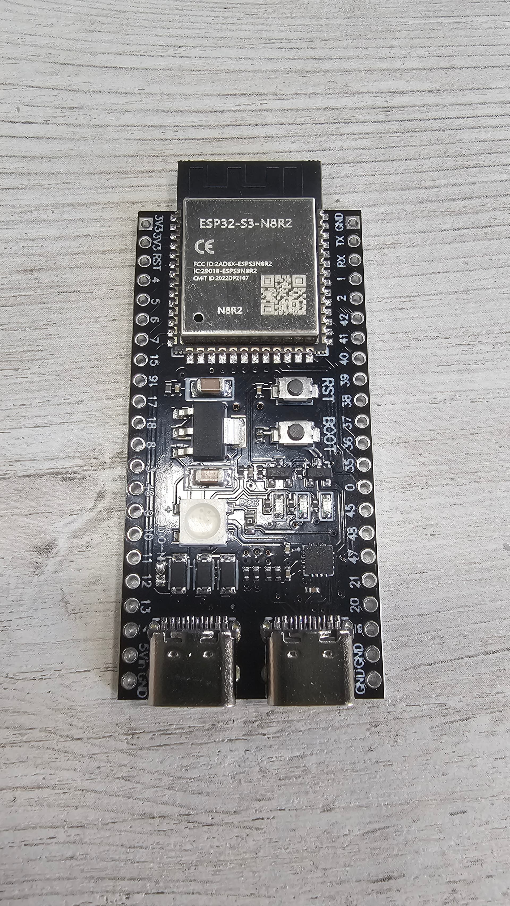

hardware_boards

https://img.lazcdn.com/g/p/faa3472ce2a38c4525f2da87648ff552.jpg_720x720q80.jpg_.webp
QIUWU INA226 36

https://www.lazada.co.th/products/i16153635000-s127153184199.html?urlFlag=true&mp=1
IRF520 โมดูลมอสเฟต โมดูลสวิตช์อิเล็กทรอนิกส์ MOSFET , Power Electronic Switch Relay IRF520 MOSFET Driver Module

https://www.lazada.co.th/products/i5058963624-s21383045058.html

Модуль контроля максимального входного тока QIUWU INA226 36 В, компактный форм-фактор, для портативных зарядных устройств и электронных устройств.
А1

Dc-Dc Step-Down Module 300W 20A Step-Down 6-40 Volt to 1.2-35 Volt Buck Converter
https://www.lazada.co.th/products/i5137528536-s21701889877.html?urlFlag=true&mp=1

https://www.lazada.co.th/products/i5302051798-s22569510368.html?urlFlag=true&mp=1

2x Store Yueqin3 3S 4S 40A 60A Li-Ion 18650 Lithium Battery Charger Protection Board Bms for Drill Motor 11.1V 12.6V/14.8V 16.8V Add Balance

https://www.lazada.co.th/products/i16196743077-s127333352635.html?urlFlag=true&mp=1&tradePath=omItm&tradeOrderId=1123175011256344&tradeOrderLineId=1123175011356344
Fast Charging Module 90W
ชาร์จเร็ว 100W แบบสองพอร์ต OPPO/OnePlus/Honor/Huawei
30 Days Free Returns
No Warranty

Cancelled - MORE DETAILS
฿225.00
Qty:  1

Fast Charging Module 90W
ชาร์จเร็ว 100W แบบสองพอร์ต OPPO/OnePlus/Honor/Huawei

5v step down for esp32 and others boards for 5v. 
LM2596 DC-DC 
https://img.lazcdn.com/g/p/e75d8f9d8bdad0c015e5487c7e70e57c.png_720x720q80.png_.webp

24V boost!
Dc Power Boost Module Board 600W 10A Dc-Dc Step up Boost Converter Step-Up Boost Converter Increase Voltage Input 10–60V Output 12–80V Dc Power Adjustment Circuit Board
App
5
https://img.lazcdn.com/g/p/1f75b07f9a3d733ff16bd71379c5ab37.jpg_720x720q80.jpg_.webp

ESP32-s3 N8R2

display oled gme12864
